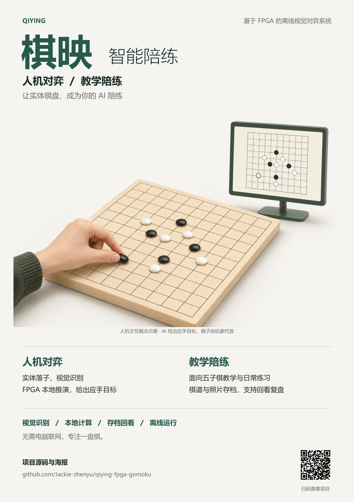

# 棋映智能陪练

**人机对弈 · 教学陪练 · 实体视觉 · 离线运行**

棋映将实体棋盘、摄像头和FPGA连接起来：摄像头观测真实落子，FPGA维护正式棋局、执行规则与AI搜索，再通过HDMI画面和离线语音提供反馈。玩家在实体棋盘上操作，电脑方的目标位置由屏幕提示，实际代放仍需经视觉确认。

本仓库整理当前演示工程的源码、必要IP与初始化资产，以及精选仿真测试和语音配置工具。已验证的主流程包括实时画面、实体对弈、AI应手提示、棋谱与照片保存/历史回看，以及独立供电下脱离电脑运行。

## 作品海报

[下载海报 PDF](docs/poster.pdf) · [查看高清 PNG](docs/poster.png)

海报为A3竖版，PDF约2.51MB，可用于要求PDF且小于50MB的作品海报提交。面向五子棋教学演示与日常陪练；插画为人机交互概念示意，实际AI落子由玩家按目标提示代放。当前教学交互的工程边界见下方“已知边界”。



## 当前工程

在安路 **Tang Dynasty（TD）6.2.1** 中打开 [`fpga/Qiying_FPGA.al`](fpga/Qiying_FPGA.al)。工程中的工具版本字段为 `6.2.168116`，顶层为 `system_top`，目标器件为 **PH1A180SFG676**。硬件平台为米联客MLK-H10底板与CK203核心板，配合IMX415摄像头、HDMI显示器和CI1302离线语音模块。

工程以本地相对路径引用源码。请保留整个 `fpga/` 目录结构，并让TD以该目录作为工程工作目录；字体、查找表、DDR初始化文件、约束及厂商IP均属于工程依赖。其余 `.al` 文件保留原有工程定义供阅读，当前入口以 `Qiying_FPGA.al` 为准。

| 目录 | 内容 |
|---|---|
| [`fpga/`](fpga/) | 当前演示工程、Verilog/SystemVerilog、约束、字体及其他初始化数据 |
| [`fpga/uisrc/`](fpga/uisrc/) | 板级基础工程与厂商采集、显示、DDR、PLL等IP |
| [`tests/`](tests/) | 语音协议、设置、SPI资源归属、配置存储和交互控制的精选testbench |
| [`tools/voice/`](tools/voice/) | 8条控制口令、25条播报词条及离线配置工作簿生成工具 |
| [`docs/`](docs/) | 作品海报PDF和高清预览图 |

## 阅读与验证

建议先阅读 `fpga/uisrc/01_rtl/system_top.v`，再查看 `qy_human_ai_video.v`、`qy_human_ai_game.v`、`qy_gomoku_search.v` 和 `qy_peripheral_voice.v`。`qy_` 前缀模块涵盖棋盘观测、规则、搜索、存储与交互；部分实验模块为保持工程完整而保留，文件存在并不表示当前顶层启用了该功能。当前顶层采用 `qy_clip_nn_idle`，不将保留的YOLO/神经网络模块视为已启用的板上推理功能。

精选测试需要Python 3.9或更新版本，以及可从PATH调用的Icarus Verilog（`iverilog`、`vvp`）。例如在仓库根目录执行：

```text
python tests/run_unit_tests.py --list
python tests/run_unit_tests.py voice
```

测试入口只运行本地RTL仿真，输出到被Git忽略的 `build/tests/`，不连接串口或板卡。测试源码保留自项目开发阶段；本次发布整理只完成文件依赖、Python语法与发布范围检查，未重新执行这些测试，也未进行综合、布局布线、时序签核或硬件下载。详细说明见 [`tests/README.md`](tests/README.md)。

语音工具生成配置资料，不生成或烧录语音芯片固件。配置模板默认禁用语音，不能据此判断实物固件状态。使用方法和协议见 [`tools/voice/README.md`](tools/voice/README.md)。

## 已知边界

- 当前版本以实体演示为目标，既有实现仍有负时序余量，不能视为时序完全通过或完成工程签核。
- 语音C2“请求提示”曾出现提示消失及自动重复播报，尚未完成物理修复；C3的有效提示重听分支未完成整机验证；C8回到主页可用，但缺少播报。不能把8条口令的配置数量等同于所有场景均已验证。
- NFC不属于当前验收范围。独立的读档续下候选与其他历史修补候选未合入本仓库当前演示工程；历史回看不等同于恢复当前RAM棋局继续对弈。
- 未收录历史构建数据库、编程位流、Flash备份、用户聊天、运行日志及大量重复实验快照。不能用本仓库替代原始实验记录或声称重建位流与既有物理补丁逐字节一致。

## 来源与权利说明

`uisrc/` 包含米联客、安路及其他厂商提供的基础工程与IP，原有版权和保护声明均保留；详见 [`THIRD_PARTY_NOTICES.md`](THIRD_PARTY_NOTICES.md)。仓库未新增统一开源许可证，也不代表对第三方文件重新授权。使用、修改或分发相关内容，应遵守对应权利人的许可条件。

发布整理仅将工程及IP封装中的机器路径改为相对路径，并整理了测试/工具入口；FPGA有效逻辑与约束未作功能修改。
